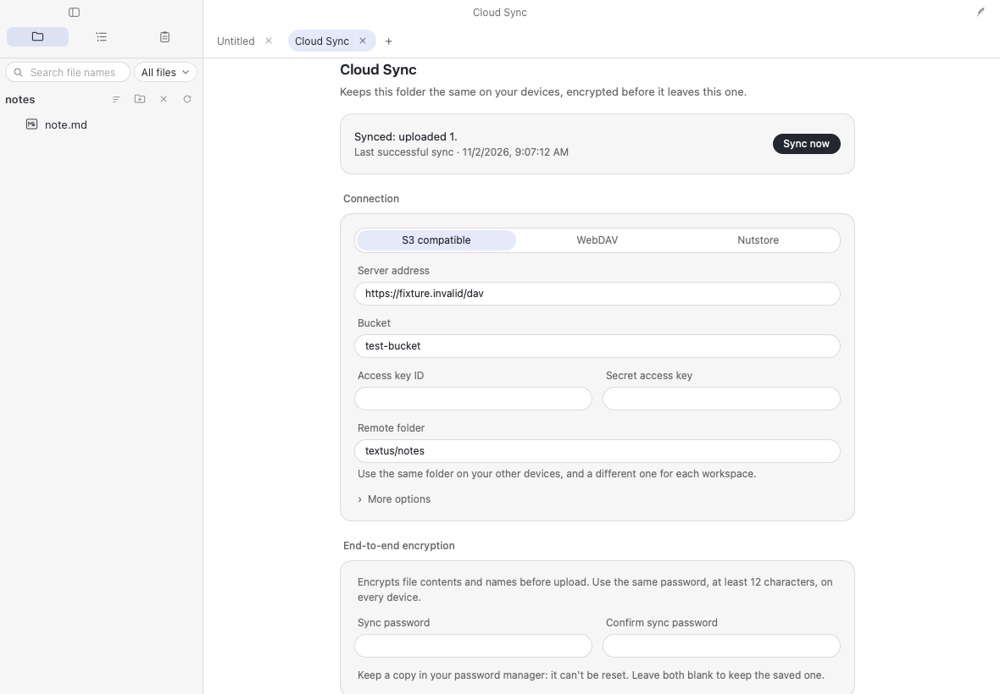
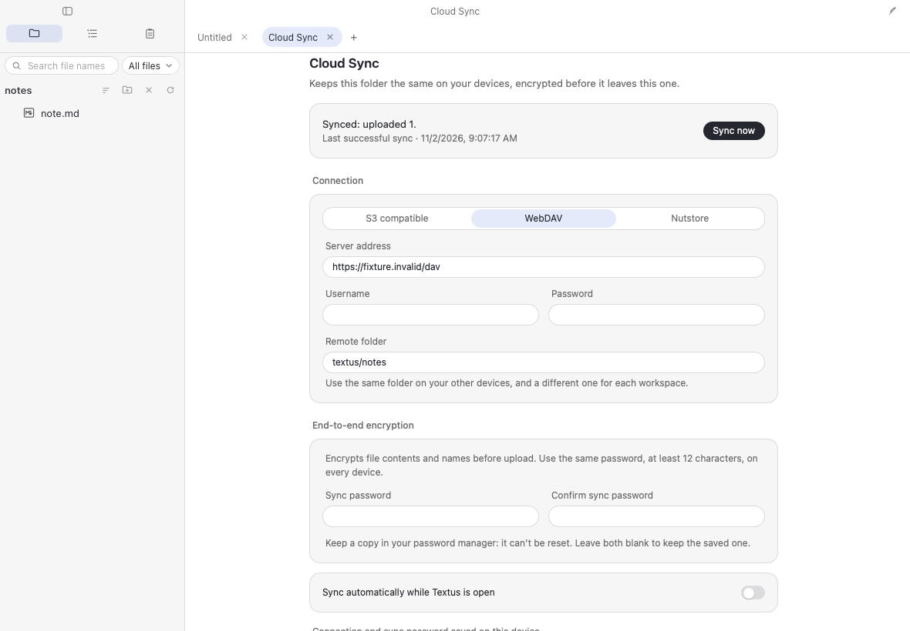
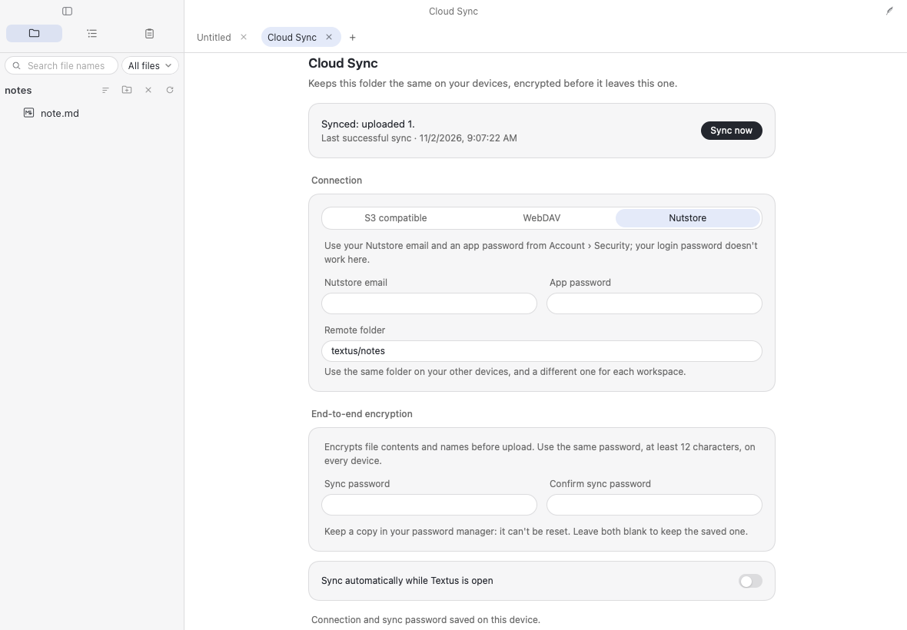
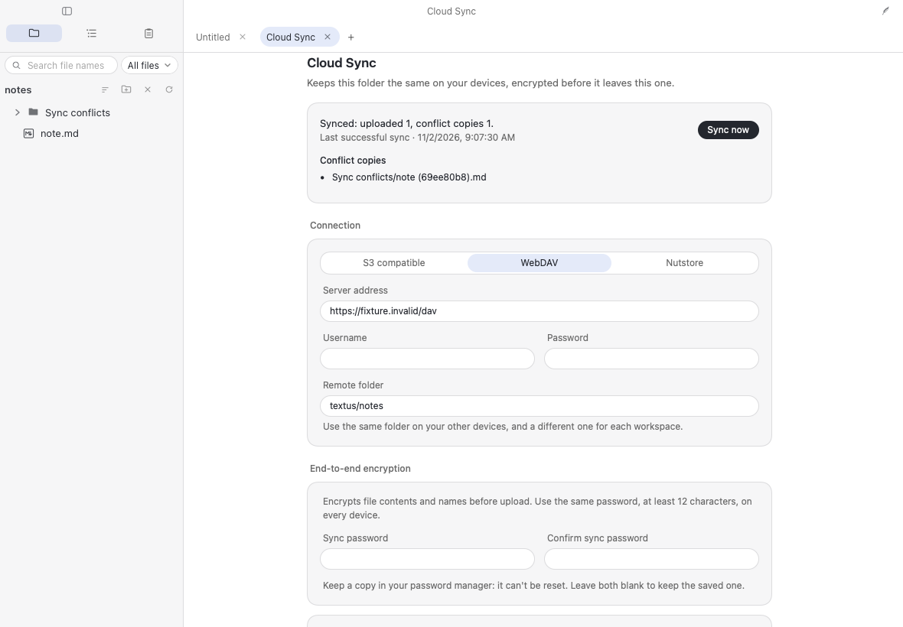
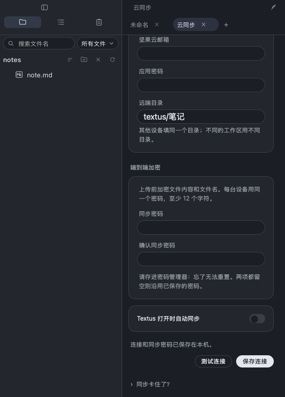
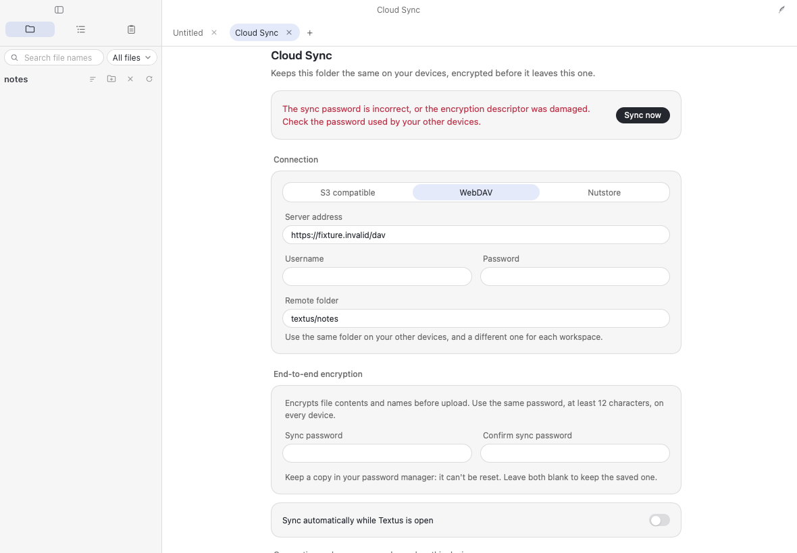
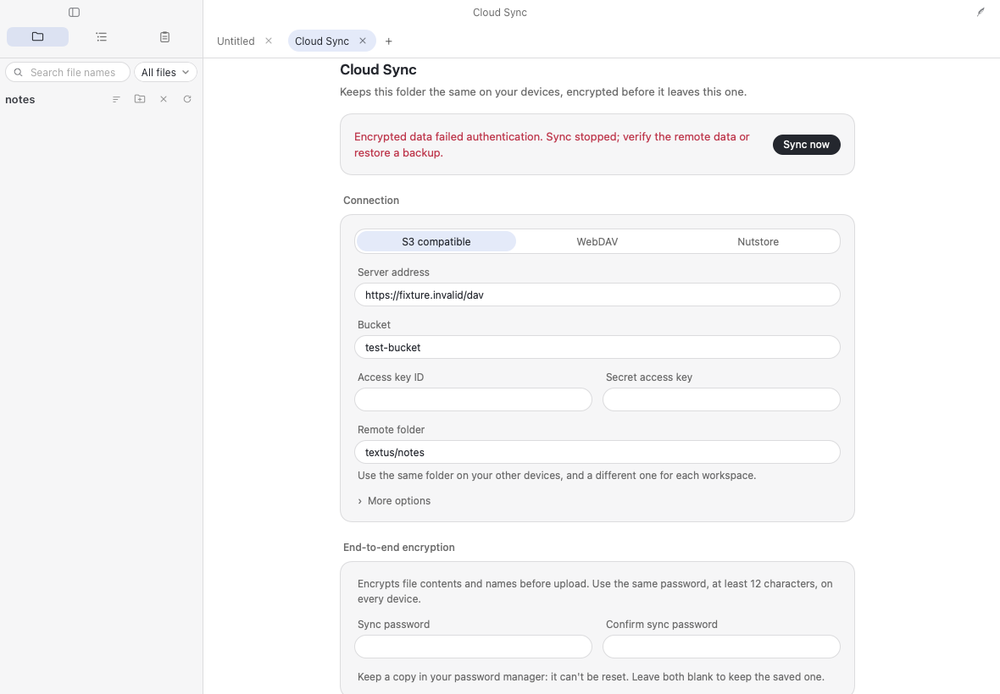

# Official Cloud Sync validation

Validated on 2026-11-02 for `catvinci.cloud-sync` 0.3.0. This is the official
plugin migration of Ciao1019/textus-cloud-sync at `59baab6`, including ChengAo
Shen's merged 0.3.0 interface improvements. The synchronization and encryption
protocols are unchanged; the plugin ID and local storage namespace are new.

## Environment

| Component                  | Version                                           |
| -------------------------- | ------------------------------------------------- |
| Textus                     | 1.3.2, `b609f49b11ecddc10f52840a502ad5d26e8ebc79` |
| Plugin repository baseline | `93de094`                                         |
| Platform                   | macOS 26.5.1, Apple Silicon                       |
| Node / npm                 | 24.20.0 / 11.19.0                                 |
| Vitest / Playwright        | 4.1.12 / 1.64.1                                   |
| Chromium / WebKit          | 156.0.8078.4 / 27.2                               |

The Textus checkout used for these tests is isolated from the user's working
checkout and production application data. The integration suite reads the
actual catalog-generated ZIP, including its official ID, manifest, host and
panel. Textus's real frontend, sandbox and broker run with development
filesystem fixtures and an intercepted native HTTP boundary. No request
reaches a real cloud account, including the Nutstore preset address.

## Commands and results

```sh
npm ci
npm run build:cloud-sync
npm run check
npm run build
CAPTURE_EVIDENCE=1 TEXTUS_REPO=/path/to/Textus-1.3.2 \
  PLAYWRIGHT_BROWSERS_PATH=/private/tmp/textus-playwright PLAYWRIGHT_PORT=1578 \
  npm run test:e2e:cloud-sync
```

`TEXTUS_REPO`, `PLAYWRIGHT_PORT` and the browser cache path are local overrides.
The default app checkout is `../Textus`; Playwright can use its default cache
after `npx playwright install chromium webkit`.

| Check                              | Result                                                                        |
| ---------------------------------- | ----------------------------------------------------------------------------- |
| Clean `npm ci`                     | Passed; lockfile installs without modification.                               |
| TypeScript and runtime consistency | Passed; checked-in host/panel match an in-memory rebuild.                     |
| Repository unit tests              | **175 passed in 32 files**, including all 82 Cloud Sync protocol/logic tests. |
| Catalog validation                 | 40 official manifests, 0 community listings and 20 skills.                    |
| Catalog build                      | Passed; Cloud Sync is `official: true`, version 0.3.0, desktop only.          |
| Chromium integration               | **9 passed**.                                                                 |
| WebKit integration                 | **9 passed**.                                                                 |
| Package/source consistency         | All 10 ZIP entries match the plugin folder byte for byte.                     |

[Check log](logs/check.txt) · [Integration log](logs/integration.txt) ·
[WebKit screenshot refresh](logs/screenshots.txt).
The WebKit flows were rerun after adjusting screenshot scroll positions to
keep the relevant heading or input in view. Test assertions were unchanged.
Logs retain outcomes and timings; local repository paths are replaced with
`<plugin-repo>` and terminal color codes removed.

Cloud Sync's unit coverage includes independent Node cryptographic
interoperability, wrong passwords, tampered ciphertext/nonce/context,
cross-repository substitution, descriptor pinning, encrypted multi-block
attachments, keyed names, conflicts, upload ordering, retries, locks, local
write races and interrupted binary reservations. Localhost protocol fixtures
verify S3 signatures and exclusive writes, WebDAV/Nutstore MOVE behavior,
authentication error redaction and rate limits.

Each browser engine runs the same nine flows: S3, WebDAV and Nutstore setup
and encrypted sync; two-device convergence with conflict copies; Chinese
validation and narrow dark layout; automatic interval and Enter-to-save;
wrong-password refusal followed by a successful retry; tampered manifest
refusal; and password-confirmation/legacy-plaintext rejection. The three
provider flows assert no page errors. No security assertion was relaxed for
the official ID or the new panel.

## Screenshots

These are unmodified WebKit captures from the current official ZIP in Textus
1.3.2, using fixture documents and credentials. Desktop captures are
1180 x 820; Chinese dark mode is 560 x 780. The images demonstrate interface
states; protocol assertions verify encryption and file preservation.

### S3 encrypted upload



### WebDAV encrypted upload



### Nutstore preset



### Concurrent edits preserve both versions



### Chinese dark mode and narrow layout



### Wrong password stops sync



### Tampered ciphertext stops sync



## Migration and validation limits

- The official and community IDs have separate local secrets, descriptor pins,
  baselines and pending-download journals. Finish interrupted sync in the old
  plugin, disable it, and re-enter the connection and sync password in the
  official plugin. Encrypted remote data is compatible; no automatic local
  secret migration or remote data rewrite is performed.
- A maintainer [reported successful live Cloudflare R2 testing](https://github.com/Ciao1019/textus-cloud-sync/pull/1)
  of the earlier community 0.2.0 plugin in Textus 1.3.0, including wrong
  passwords and conflicts. That is separate evidence, not a new live-cloud
  test of this official build. Live WebDAV and Nutstore remain unverified.
- This migration was not run in a native macOS/Windows/Linux app. WebKit
  browser coverage does not establish iOS support; the manifest is desktop
  only. No Textus application code was changed and its full `check:all` suite
  was not rerun.
- Encryption has no independent audit. Object sizes/counts, timing and block
  reuse are observable, and malicious replay of old authenticated state is
  not guaranteed to be detected. Local workspace files remain readable.
- Deletion propagation, remote garbage collection, password-reset recovery,
  in-place password rotation and single-snapshot restore UI are not provided.
  Existing binary changes keep both copies and open destinations are deferred.
- The `network:*` policy now explicitly permits user-entered HTTPS storage
  servers; see [LISTING.md](../../LISTING.md). The previously blocking catalog
  bug was fixed in merged PR #12. Human review is still needed before merging
  and publishing the official plugin.
